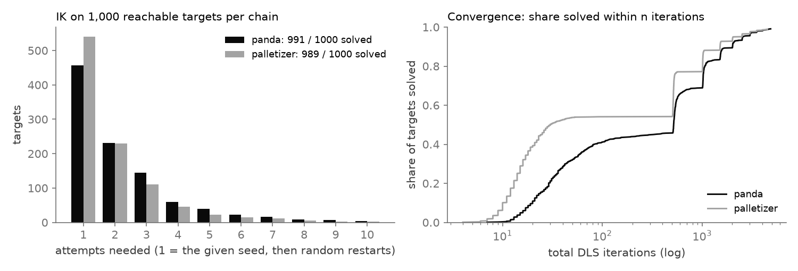
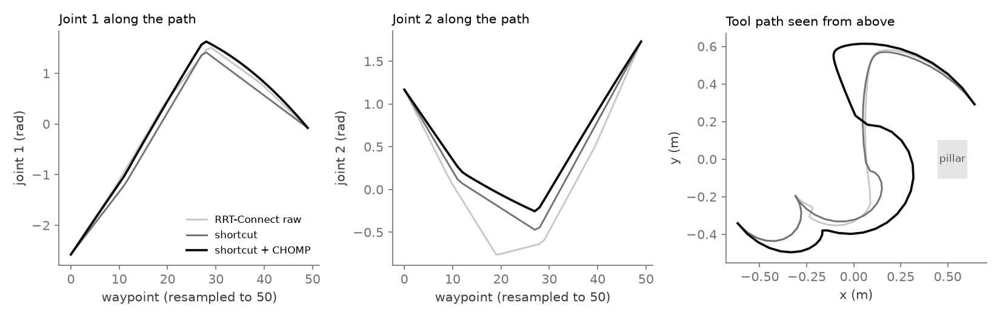
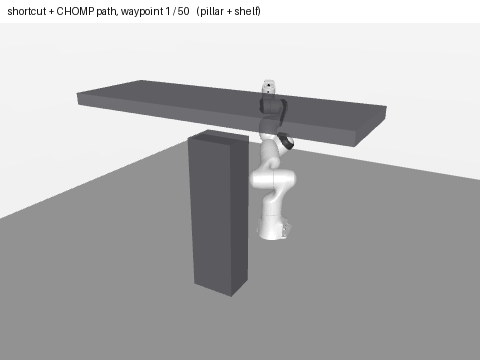
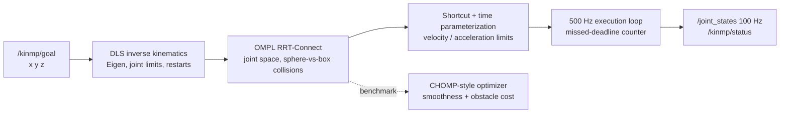

<div align="center">

# kinmp: C++ Kinematics and Motion Planning

**Exact forward kinematics, IK that reports when it fails, and planned paths that go around obstacles, in C++17.**

Eigen kinematics for serial chains described by a DH table (a Franka Panda and a custom 4-axis palletizer), OMPL
RRT-Connect planning with shortcutting and a CHOMP-style optimizer, and a ROS 2 node that runs IK → plan → execute
in a 500 Hz loop that counts its own missed deadlines. The kinematics are checked against MuJoCo, finite
differences and MATLAB.

[**Project page →**](https://dheepakkaran.github.io/cpp-kinematics-motion-planning/) · [Results](RESULTS.md) · [Build notes](BUILD-LOG.md)


<a href="https://dheepakkaran.github.io/cpp-kinematics-motion-planning/#overview"></a>

<sub>35-second overview (silent preview). <a href="https://dheepakkaran.github.io/cpp-kinematics-motion-planning/#overview">Watch it with sound on the project page →</a></sub>

</div>

> **Simulation only.** The node drives a kinematic simulation; no dynamics and no hardware. Independent learning project.

---

## Why this exists

Kinematics and planning code fails quietly. A Jacobian with a sign error still produces motion, an IK solver can
call a near-miss a success, and a smoothed path can cut through an obstacle it used to avoid. This library builds the
pieces from a DH table and then checks each one against something independent: MuJoCo's own kinematics, finite
differences, a separate MATLAB implementation, and dense collision re-checks of every planned path.

## Results

| What | Result | Source |
|---|---|---|
| Forward kinematics vs MuJoCo 3.16 (Panda, 1,000 random configs) | max position error **1.0e-15 m** | `results/kinematics.json` |
| Jacobian vs MuJoCo `mj_jacSite` | max error **3.8e-15** | `results/kinematics.json` |
| Jacobian vs MATLAB R2026b (separate implementation, 100 configs per chain) | max error **3.3e-16** (Panda), **4.4e-16** (palletizer) | `results/matlab_check.txt` |
| Inverse kinematics, 1,000 reachable targets per chain | **991 / 1,000** Panda (6-D pose) · **989 / 1,000** 4-axis palletizer | `results/kinematics.json` |
| OMPL RRT-Connect on 20 moves where the straight path hits obstacles | **20 / 20** solved and valid, median **2.2 ms** | `results/planning.json` |
| Median path length: raw → shortcut → shortcut + CHOMP | 12.85 → 10.04 → **9.41 rad** (**27% shorter**) | `results/trajopt.json` |
| 500 Hz execution loop, best of 4 runs | **8** missed deadlines out of 5,802 cycles (219–620 in the other runs, under load) | `results/rt_loop_run1.json` |
| Tests | **10** GoogleTest cases, 0 failures | `results/gtest_xml/` |

| Variant (20 blocked queries) | Smoothness median | Length median | Clearance median | Time median |
|---|---|---|---|---|
| RRT-Connect raw | 0.126 | 12.85 rad | 0.018 m | – |
| Shortcut (used by the node) | 0.047 | 10.04 rad | 0.030 m | 1.0 ms |
| CHOMP from raw | 0.093 | 11.70 rad | 0.062 m | 357 ms |
| **Shortcut then CHOMP** | **0.024** | **9.41 rad** | 0.050 m | 364 ms |

CHOMP alone is less smooth, longer and about 365× slower than shortcutting; its one gain is clearance. Shortcut
then CHOMP is the best on smoothness and length. The node still executes the shortcut path, because its timing step
stops at every waypoint.

### Demo: IK across 1,000 targets, and one planned path three ways



*Every one of the 1,000 IK targets per chain from the test, re-run by the new `kinmp_demo_dump` tool with the same
random generator and seeds (991 and 989 solved again). Left: most targets solve from the given seed; the rest need
random restarts. Right: share solved within n damped-least-squares iterations; the steps are the 500-iteration
restarts.*



*The first of the 20 blocked Panda queries from the benchmark (same generator and planner seed). The C++ tool
re-checks each version densely: all collision-free; joint-space length 13.40 → 11.38 → 10.64 rad. CHOMP optimizes
joint-space smoothness, so its tool path seen from above can be wider.*



*The shortcut + CHOMP joint path re-posed in MuJoCo (Python bindings) and rendered headless with EGL; dots trace the
tool. Nothing is planned or simulated again for the picture. Figures: `scripts/make_demo_figures.py`.*

## How it works



1. **Kinematics** (`include/kinmp/kinematics.hpp`, header-only): `Chain` from a DH table (standard or modified), passive coupled joints (`q_full = C q`), tool frame; FK as `Eigen::Isometry3d`, geometric Jacobian, damped-least-squares IK with joint limits, task masks and random restarts.
2. **Two chains:** Franka Panda 7-DOF (modified DH) and a custom 4-axis palletizer (base yaw, shoulder, elbow, wrist yaw; a passive wrist pitch `-(q2+q3)` keeps the tool level).
3. **Planner** (`planner.hpp`, `src/planner.cpp`): OMPL RRT-Connect; collisions = spheres along the links vs boxes; OMPL `reduceVertices` + `partialShortcutPath`; trapezoidal timing.
4. **Trajectory optimizer** (`chomp.hpp`, `src/chomp.cpp`): 50 waypoints, squared second differences + signed-distance obstacle cost, covariant gradient descent, fixed endpoints, joint-limit clamping.
5. **ROS 2 node** (`src/planning_node.cpp`): goals on `/kinmp/goal`, `/joint_states` + JSON `/kinmp/status` out; a separate 500 Hz execution thread records lateness.
6. **MATLAB check** (`matlab/check_kinematics.m`): rebuilds both chains from scratch and compares FK and Jacobians on samples exported by the C++ tests.

## Design decisions

| Decision | Why |
|---|---|
| **Chains from DH tables, not hand-written FK** | the same code serves the Panda and a made-up palletizer, including a passive coupled joint |
| **Check against independent implementations** | MuJoCo and MATLAB catch convention mistakes (DH type, tool frame) that self-consistency tests cannot |
| **IK success on the error norm, with restarts** | a per-axis check let 1.6e-4 m "successes" through; restarts turn 457 first-seed solves into 991 |
| **Dense re-check of every path at 0.01 rad** | smoothing and optimization can cut corners; each variant is re-validated, not trusted |
| **CHOMP benchmarked, shortcut executed** | measured trade-off: CHOMP buys clearance and smoothness for ~365× the time; the node needs a uniform-time parameterization first |
| **Missed-deadline counter in the loop** | soft real time on a normal kernel has to be measured, not assumed |

## What broke / what changed

1. **IK tolerance was checked per axis**, so some "successes" were 1.6e-4 m off against a stated 1e-4 m. A norm check, 10 attempts and 500 iterations took the Panda from 929 to 991 / 1,000 honestly.
2. **CHOMP's step halving gave up too early**: cost fell on only 9 of 20 queries. Allowing 30 halvings fixed it (20 / 20).
3. **OMPL 2.0 renamed `shortcutPath`**; the build switched to `partialShortcutPath`.
4. **The 500 Hz loop missed 620 of 4,712 deadlines** in one run on a loaded machine. The counter caught it; the trajectory still ended on the goal because setpoints are sampled from wall-clock time.
5. **A small reporting bug remains:** the per-goal "done" message can count one missed deadline too few; the total in `rt_loop.json` is correct.

## Run it

Uses [pixi](https://pixi.sh): no sudo. It pulls ROS 2 Jazzy from RoboStack, conda-forge gcc, `libmujoco` 3.16, `eigen` 5.0.1 and `ompl` 2.0.2.

```bash
pixi install
scripts/build_and_test.sh                              # colcon build + colcon test + test results
pixi run install/kinmp/lib/kinmp/kinmp_planning_node   # run the node on its own

pixi run install/kinmp/lib/kinmp/kinmp_demo_dump results/demo    # demo CSVs (about 5 s)
MUJOCO_GL=egl uv run --with mujoco --with matplotlib --with pandas --with pillow python scripts/make_demo_figures.py
```

To check the kinematics in MATLAB, upload `matlab/online-upload/run_kinmp_check.m` to MATLAB Online and run
`run_kinmp_check`. GNU Octave works too (`pixi install -e octave`).

## Repo map

| Path | What |
|---|---|
| `include/kinmp/` | `kinematics.hpp` (chains, FK, Jacobian, IK), `planner.hpp`, `chomp.hpp`, `scene.hpp`, `planning_node.hpp` |
| `src/` | planner, CHOMP optimizer, ROS 2 node, `main` |
| `test/` | GoogleTest: kinematics (5), planner (2), CHOMP (2), ROS 2 node (1) |
| `tools/demo_dump.cpp` | per-target IK results and one planned path three ways, as CSV |
| `matlab/` | MATLAB / Octave check, one-file MATLAB Online version |
| `scripts/` | `build_and_test.sh`, `env.sh`, `make_demo_figures.py` |
| `results/` | kinematics, planning, CHOMP and loop JSON, MATLAB output, test logs, demo CSVs |
| `docs/index.html` | the project page (GitHub Pages) |

## Limits

- **Kinematic simulation only:** setpoints on `/joint_states`, no dynamics, no hardware.
- **Soft real time:** normal Linux kernel and `sleep_until` on `steady_clock`; no PREEMPT_RT or SCHED_FIFO.
- **Simple collisions:** spheres vs boxes, no meshes, no self-collision. Planning and the node use the Panda only.
- **Numerical IK:** about 1% of random targets fail within 10 attempts.
- **Topic, not service:** the goal arrives on a ROS topic, not a service or action.

## Next

Uniform-time parameterization so the node can execute CHOMP paths · self-collision and mesh collisions · a service
or action interface · CI and a Dockerfile · a SCHED_FIFO / PREEMPT_RT experiment.

## Credits

Franka Emika Panda model from [MuJoCo Menagerie](https://github.com/google-deepmind/mujoco_menagerie) (Apache-2.0, see `assets/franka_emika_panda/LICENSE`).
Author: Dheepak Karan Elumalai Santhakumari.
